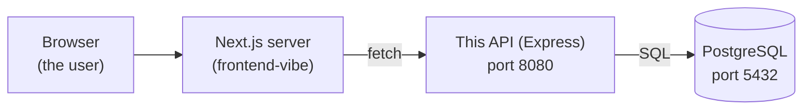
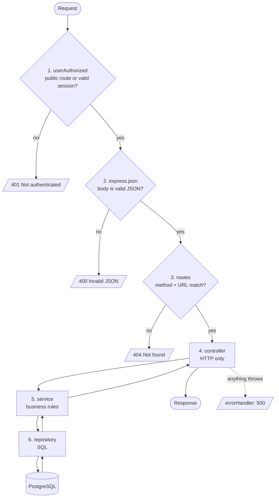
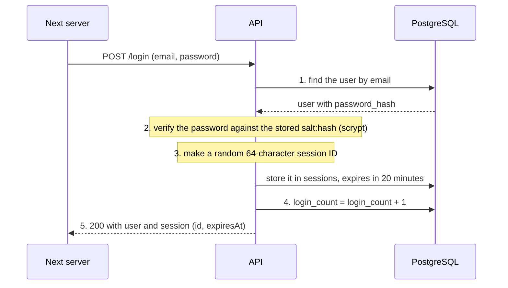
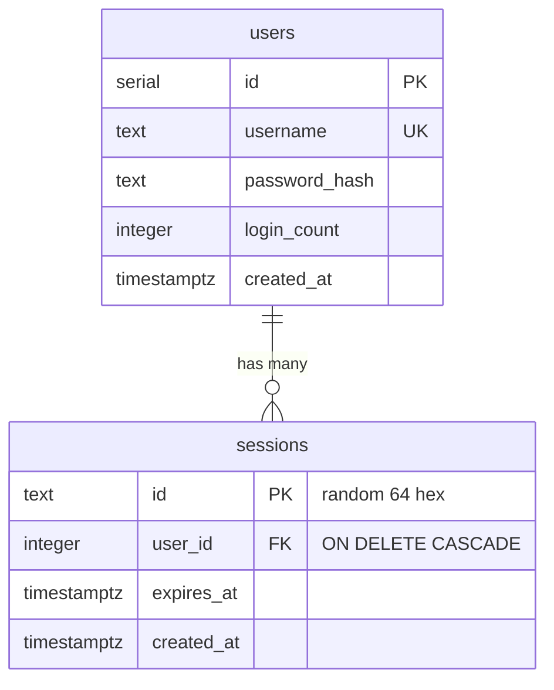

# Architecture

How the backend is built. For the reasons behind each choice, follow the
links to the decision records in [decisions/](decisions/).

## The big picture

Only the Next.js server calls this API. The browser never does, and only this
API talks to the database. See [0001](decisions/0001-separate-backend.md).

## What happens to a request

Every request walks the same line, in this order (defined in `app.ts`):

The answer travels back up the same way it came down (repository, service,
controller, response).

The order matters. The guard is first so that an unauthenticated request is
rejected before any work is done. The error handler is last so it catches
everything above it. See [0006](decisions/0006-default-deny-guard.md).

## The layers

Each feature is a folder in `modules/` split into the same four files. Each file
has one job and is not allowed to do the others' jobs.

| File | Job | May not |
|---|---|---|
| `*.routes.ts` | Connect a URL and method to a controller function | contain logic |
| `*.controller.ts` | HTTP only: read `req`, call the service, pick the status code, write `res` | contain business rules or SQL |
| `*.service.ts` | Business rules (validation, hashing, deciding "duplicate" or "wrong password") | know about `req`/`res` or status codes, or write SQL |
| `*.repository.ts` | SQL only: send a query, return rows | contain business rules |

A concrete example, signup:

- The **controller** reads `email` and `password` from `req.body`.
- The **service** checks the email and password rules, hashes the password, and
  returns either `{ reason: "validation", errors }`, `{ reason: "duplicate", ... }`
  or the new user. It does not know what a 400 or 409 is.
- The **controller** turns `validation` into 400, `duplicate` into 409, and a
  user into 201.
- The **repository** runs the `INSERT`. If Postgres says the email already
  exists (error code `23505`), it returns `null` instead of crashing.

Why the split helps: the service can change without touching HTTP, the database
code can be replaced (an ORM later) without touching the rules, and you always
know where to look. See [0003](decisions/0003-layered-modules.md).

Only repositories import the database pool. The `users` table belongs to the
users module, so the auth module reaches it through `usersService`, never with
its own SQL on that table.

## Sessions: how login works

Step 4 is one SQL statement, not "read the number, add 1, write it back", so
two simultaneous logins cannot lose a count.

The session ID is just a random lookup key. All the information lives in the
database row. Logging out deletes that row, so it takes effect immediately.
See [0002](decisions/0002-server-side-sessions.md).

Every protected request carries `Authorization: Bearer <id>`. The guard asks
the database "is there a session with this ID that has not expired?" It does
this on every request, because it is a cheap lookup by primary key.

`GET /users/me` is not the security check. It is a feature that returns the
user. The security check is the guard in front of every protected route.

## Data

Two tables, created in `db.ts` with `CREATE TABLE IF NOT EXISTS`:

One user has many sessions. Deleting a user deletes their sessions.
`username` holds the email the user typed. There is no separate email column.

## Errors

| Situation | Where it is caught | Response |
|---|---|---|
| Missing or expired session | `userAuthorized` | 401 `{ message: "Not authenticated" }` |
| Malformed JSON body | `errorHandler` | 400 `{ message: "Invalid JSON" }` |
| Empty or non-object body | controller | 400 `{ message: "Invalid JSON" }` |
| Failed validation | service result, mapped by controller | 400 `{ errors }` |
| Email already registered | service result, mapped by controller | 409 `{ errors }` |
| Wrong email or password | service returns `null`, mapped by controller | 401 |
| Unknown URL | `notFound` | 404 |
| Anything unexpected | controller `try/catch` or `errorHandler` | 500 `{ message: "Something went wrong" }` |

Expected outcomes (wrong password, duplicate email) are return values. Only
unexpected failures are exceptions.

## Adding a feature

See "Add a new API" in the [README](../README.md#add-a-new-api). The short
version: a new folder in `modules/`, the same four files, one line in
`routes/index.ts`.
